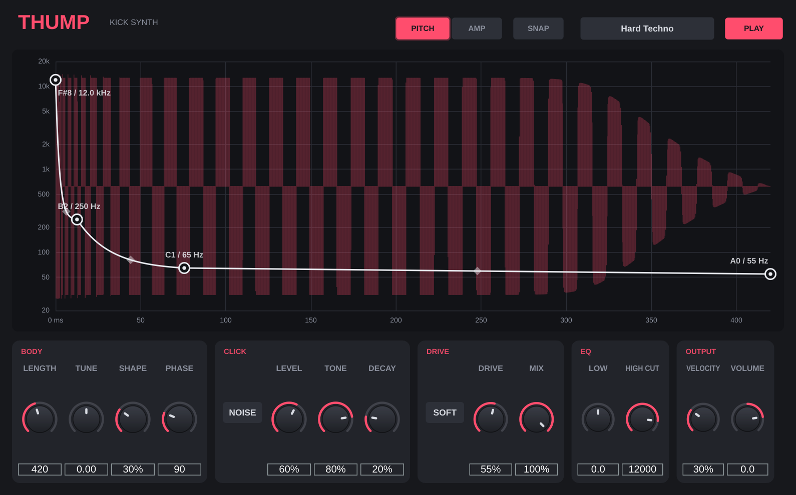

# Thump — kick synth (VST3 / AU / Standalone)

An original kick drum synthesizer built with JUCE. Draw the pitch and amplitude of your kick
as curves, layer a click, drive it, EQ it, trigger it from MIDI.



## Features
- **Pitch curve** on a log scale (20 Hz–20 kHz), each point labelled with note name and Hz.
  Snap mode locks points to semitones so the tail is in key.
- **Amp curve** for the volume shape.
- Curve editing: drag points, drag the diamonds to bend a segment, double-click to add a point,
  double-click or right-click a point to delete it, double-click a diamond to straighten it.
- **Live waveform** of the exact kick you will hear, drawn behind the curve.
- **Body**: length (50–2000 ms), tune ±24 st, shape (sine → driven), start phase.
- **Click layer**: filtered noise or a fast "snap" chirp, with level, tone and decay.
- **Drive**: soft, hard clip, wavefolder, bit crush, with dry/wet mix.
- **EQ**: low shelf boost/cut at 60 Hz, high cut.
- **Output**: velocity sensitivity, volume, soft ceiling below 0 dBFS.
- Any MIDI note triggers the kick; retriggers crossfade in 2 ms so they never click.
- 10 factory presets:
  - General: Init Punch, Deep 808, Hard Techno, Hardstyle Tail, Lo-Fi Thud
  - **Trance - Uplifting** (~138 BPM): warm ~55 Hz tail that is gone by the offbeat bass, bright click
  - **Trance - Psy 145 G1**: exactly a 1/8 note at 145 BPM, resolves on G1 (49 Hz), "fishtail" amp shape
    (snap, dip, boom) to leave room for a rolling bassline. Retune the last pitch points with SNAP for other keys,
    and set Length to 30000 / BPM ms for other tempos.
  - **Melodic - Deep** (~124 BPM): round ~48 Hz tail, dark soft click
  - **Melodic - Main Stage**: shorter, punchier, more drive, between techno and trance
  - **Melodic - Rumble Layer**: long dark saturated sub tail with no click. Put it on its own track under the
    main kick, add reverb, and sidechain it to the main kick.
- Curves and settings save with your DAW project.

## How it works
A kick is fully determined by its settings, so Thump renders the complete hit into a buffer
whenever you change something, then plays that buffer back on each MIDI note. Note-ons cost
almost no CPU, and the waveform display is exactly the output. Old buffers stay alive for 10 s so
a kick that is still ringing never loses its audio.

## Build
Same as Squelch: push to GitHub and the included Actions workflow builds Windows, macOS and Linux,
or build locally:
```
cmake -B build -DCMAKE_BUILD_TYPE=Release
cmake --build build --config Release
```
Output: `build/Thump_artefacts/Release/VST3/Thump.vst3`.

Engine-only test (no JUCE): `g++ -O2 -std=c++17 tests/render_demo.cpp -o rd && ./rd`

## License note
JUCE 8 is AGPLv3 or commercially licensed (free tier for small developers). Check the terms
before distributing binaries.
